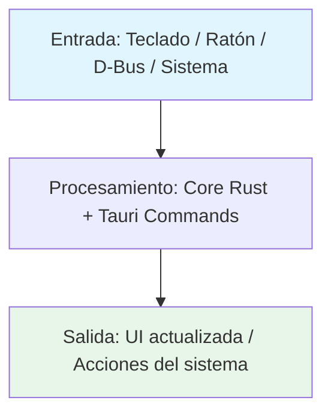
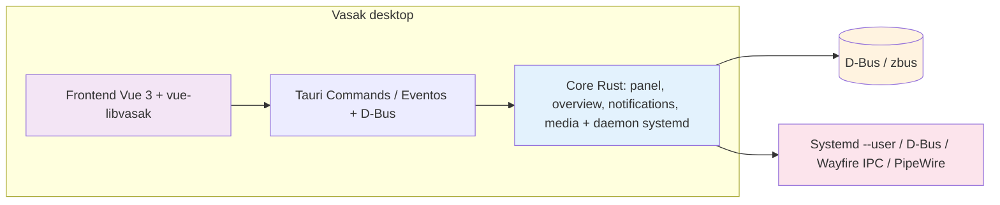
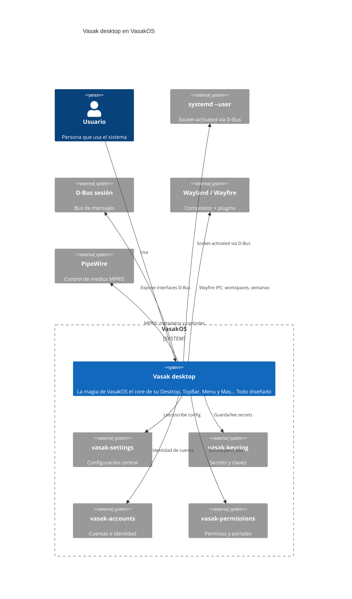

# Vasak desktop

La magia de VasakOS el core de su Desktop, TopBar, Menu y Mas... Todo diseñado con VueJS y Tauri para VasakOS

---

## Tecnología

[](https://www.rust-lang.org/) [](https://tauri.app/) [](https://vuejs.org/) [](https://www.typescriptlang.org/) [](https://systemd.io/)

## Estado

[](https://github.com/Vasak-OS/vasak-desktop/actions/workflows/ci.yml)
[](https://github.com/Vasak-OS/vasak-desktop/releases)
[](LICENSE)
[](https://sonarcloud.io/summary/new_code?id=Vasak-OS_vasak-desktop)
[](https://sonarcloud.io/summary/new_code?id=Vasak-OS_vasak-desktop)
[](https://github.com/Vasak-OS/vasak-desktop)

---

## Descripción

La magia de VasakOS el core de su Desktop, TopBar, Menu y Mas... Todo diseñado con VueJS y Tauri para VasakOS

**Para el usuario:** Todo diseñado con VueJS y Tauri para VasakOS

**Integración VasakOS:** Integra con el ecosistema VasakOS vía D-Bus y configuración compartida.

---

## Arquitectura (diagramas)

> Copia y pega la plantilla que necesites, descomenta y adapta.

### Flujo de datos



### Componentes internos



### Integración en el sistema VasakOS



---

## Instalación

### Arch Linux (repo oficial)

```bash
pacman -S vasak-desktop
```

### Debian / Ubuntu (.deb)

```bash
wget https://github.com/Vasak-OS/vasak-desktop/releases/download/v{{VERSION}}/vasak-desktop_{{VERSION}}_amd64.deb
sudo apt install ./vasak-desktop_{{VERSION}}_amd64.deb
```

### Desde fuente

```bash
git clone https://github.com/Vasak-OS/vasak-desktop.git
cd vasak-desktop

# Desarrollo (recarga en caliente frontend + backend)
bun run dev

# Build producción
bun run build
```

### Flatpak / AppImage

> *Placeholder: añadir cuando exista paquete Flatpak o AppImage oficial.*

---

## Uso rápido

```bash
# Se lanza automáticamente al iniciar la sesión Wayfire (systemd --user socket-activated)
# Para lanzar manualmente (debug):
vasak-desktop
```

### Atajos / flags principales

| Acción | Comando / Tecla |
|--------|-----------------|
| Acción principal | `vasak-desktop` |
| Configuración | `vasak-desktop --config` |
| Ayuda | `vasak-desktop --help` |

> **Captura:** `assets/demo.gif` *(placeholder — sustituir por GIF real)*

---

## Configuración

### Archivo de configuración

```
~/.config/vasak/desktop.toml
```

Ejemplo mínimo:

```toml
[panel]
position = "top"
height = 36
autohide = false

[overview]
blur_background = true
show_recent = true
max_recent = 8

[notifications]
position = "right"
width = 360
max_visible = 10

[media]
show_artwork = true
preferred_players = ["spotify", "firefox", "mpv"]
```

### Variables de entorno

| Variable | Descripción | Por defecto |
|----------|-------------|-------------|
| `VASAK_DEBUG` | Activa logs de depuración en consola | `false` |
| `VASAK_PROFILE` | Perfil de rendimiento: balanced, performance, power-save | `balanced` |

### Integración con `tauri-plugin-config-manager`

- Esquemas de color: respeta `--ui-primary`, `--ui-surface`, `--ui-focus`, `--ui-on-surface`, `--ui-border`
- Tema de iconos: usa el tema del sistema (`vasakos-icon-theme`) vía `vicon` lookup
- Radio de bordes: variable CSS `--ui-radius` del esquema activo (por defecto 12px)
- Fuentes: `--ui-font-family`, `--ui-font-size-base` desde el esquema

---

## Desarrollo

### Requisitos

- **Rust:** `rustup` toolchain estable (`rust-toolchain.toml` fija la versión)
- **Node / bun:** `bun` ≥ 1.1 (nunca npm/yarn/pnpm para apps Tauri)
- **Sistema:** `pkg-config`, `libgtk-3-dev`, `libwebkit2gtk-4.1-dev`, `libssl-dev`
- *`libgtk-layer-shell-dev`, `wayland-protocols`, `wayfire-dev` para Wayland*

### Dependencias de desarrollo

#### Sistema (paquetes Arch / Debian / Fedora)

`base-devel`, `pkgconf`, `libssl-dev`, `libwebkit2gtk-4.1-dev`, `libgtk-3-dev`, `libayatana-appindicator3-dev`, `librsvg2-dev`, `gstreamer1.0-plugins-base`, `gstreamer1.0-plugins-good`, `libpipewire-0.3-dev`, `libwireplumber-0.5-dev`, `libdbus-1-dev`, `libudev-dev`, `libxkbcommon-dev`, `libwayland-dev`, `meson`, `ninja`, `clang`, `lld`

#### Rust

`rustup` → `stable` + `rustfmt` + `clippy`

#### Node

**Solo `bun`** (nunca npm/yarn/pnpm para apps Tauri). `bun --version` ≥ 1.1

#### Herramientas CLI

`just` (command runner), `cargo-binstall` (opcional), `cargo-llvm-cov` (para cobertura)

### Correr en desarrollo

```bash
# Frontend (Vite dev server + Tauri dev)
bun run tauri dev

# Solo frontend (Vite)
bun run dev

# Solo backend (cargo watch)
cargo watch -x "run --bin vasak-desktop`
```

### Compilar / Build de release

```bash
# Build completo (frontend + backend + bundle)
bun run tauri build

# Solo frontend (para testear bundle después)
bun run build

# Solo backend Rust (binario optimizado)
cargo build --release --locked

# Paquetes nativos
# Arch: makepkg -sf en PKGBUILDS/vasak-desktop/
# Debian: cargo deb --no-build --target-dir src-tauri/target/release/debian
```

### Targets principales

```bash
# Desarrollo
bun run dev

# Build producción
bun run build

# Solo frontend
bun run build:frontend

# Solo backend Rust
cargo build --release --locked

# Lint + tipos (pre-commit / CI)
bunx --bun biome check .
bunx vue-tsc --noEmit
cargo fmt --check
```

### Pruebas

```bash
# Suite completa JS (Vitest via bun:test)
bun test

# Suite completa Rust (crates en pruebas_rust del CI)
cargo test -p vasak-desktop-core -p vasak-desktop-ui --locked

# Integración (requiere Wayfire corriendo)
cargo test -p vasak-desktop-integration --locked -- --ignored
```

### Convención de commits

[Conventional Commits](https://www.conventionalcommits.org/es/v1.0.0/):

```
<tipo>(<ámbito>): <descripción corta>

[cuerpo opcional]

[pie opcional: Closes #N]
```

Tipos habituales: `feat`, `fix`, `bugfix`, `docs`, `ci`, `chore`, `security`, `refactor`, `perf`, `test`.

### Cómo abrir PR

1. Rama desde `origin/main`:
   ```bash
   git worktree add -b feat/{{TEMA}} ~/wt/vasak-desktop-{{TEMA}} origin/main
   ```
2. Prefijos de rama: `fix/`, `feat/`, `bugfix/`, `docs/`, `ci/`, `chore/`, `security/`
3. Escribe el fix → **`qa` escribe las pruebas** (fallan sin el fix) → suite verde → abre PR
4. Al abrir PR, **cuatro cosas obligatorias**:
   - Asignado a `JoaquinDecima`
   - Etiqueta `enhancement` o `bug` (+ `ci` / `dependencies` si aplica)
   - Añadido al proyecto «VasakOS Roadmap»
   - Status **In Progress**

---

## Arquitectura (texto)

### Crates / módulos principales

| Crate / Módulo | Responsabilidad |
|----------------|-----------------|
| `vasak-desktop-core` | Lógica compartida: estado, D-Bus, IPC |
| `vasak-desktop-ui` | Frontend Vue 3 + componentes vue-libvasak |
| `vasak-desktop-tauri` | Puente Tauri: commands, eventos, WebView |

### Interfaces D-Bus / zbus expuestas

| Interfaz | Métodos / Señales / Propiedades | Descripción |
|----------|----------------------------------|-------------|
| `org.vasak.Vasak-desktop` | `GetState()`, `StateChanged(dict)`, `SetConfig(dict)` | Estado y control principal |
| `org.vasak.Vasak-desktop.Panel` | `SetPosition(string)`, `SetAutohide(bool)`, `Height(u32)` | Configuración panel en runtime |

### Puntos de extensión

- **Plugins:** Sistema de plugins modular
- **Hooks:** Hooks de ciclo de vida
- **API pública Rust:** API pública del crate principal

### Features / Cargo features

| Feature | Descripción | Default |
|---------|-------------|---------|
| `system-tray` | Bandeja del sistema + menú contextual | ✓ |
| `notifications` | Integración libnotify / freedesktop | ✓ |
| `updater` | Auto-actualización (tauri-plugin-updater) | |
| `devtools` | DevTools en release (solo debug) | |
| `experimental-wayland` | Protocolo Wayland inestable | |

Y para apps Tauri+Vue: features del `tauri.conf.json` → `bundle` / `plugins` / `allowlist` (capabilities).

---

## Pruebas y calidad

- **Cobertura objetivo:** ≥ 80 % del código nuevo (SonarCloud Quality Gate)
- **Informes:** GitHub Actions → pestaña *SonarCloud Code Analysis* → enlace a SonarCloud
- **Añadir pruebas:** ver `AGENTS.md` sección 9 (mapa de repos y comandos de prueba)
- **Regla:** toda corrección lleva prueba escrita por `qa` que falla sin el fix

---

## Contribuir

- **Guía:** [`.github/CONTRIBUTING.md`](https://github.com/Vasak-OS/.github/blob/main/CONTRIBUTING.md)
- **Plantillas de issue:** [`.github/ISSUE_TEMPLATE/`](https://github.com/Vasak-OS/.github/tree/main/ISSUE_TEMPLATE)
- **Código de conducta:** [`CODE_OF_CONDUCT.md`](https://github.com/Vasak-OS/.github/blob/main/CODE_OF_CONDUCT.md)

---

## Contribuidores

> **Actualizado automáticamente en CI** — muestra los avatares de quienes han aportado código a este repo.

<div align="center">
  <a href="https://github.com/JoaquinDecima" target="_blank"></a>
</div>

[Ver todos los contribuidores](https://github.com/Vasak-OS/vasak-desktop/graphs/contributors)

---

## Donadores / Sponsors

[](https://github.com/sponsors/Vasak-OS)

> **Backers:** *Actualizado automáticamente en CI desde GitHub Sponsors / OpenCollective / Polar.*

[💖 Donar al proyecto](https://github.com/sponsors/Vasak-OS)

---

## Licencia

`GPL-3.0` — Copyright © 2026 **Vasak-OS Contributors**

[Ver licencia completa](LICENSE)
